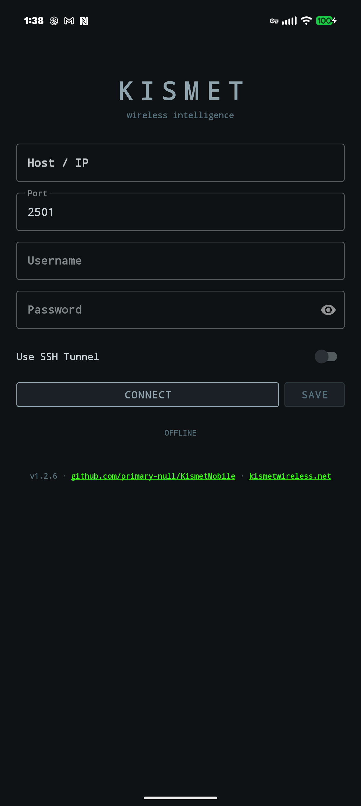
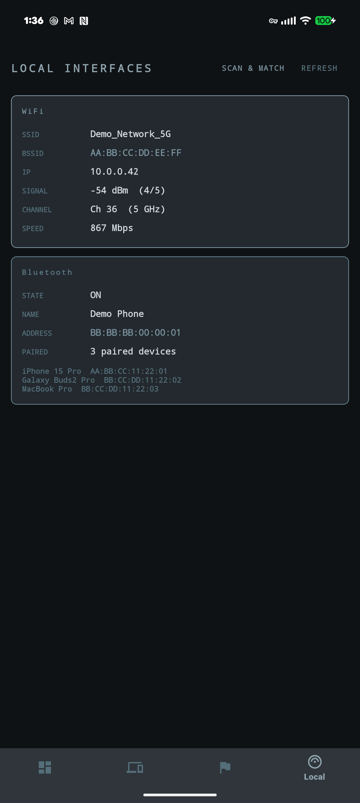
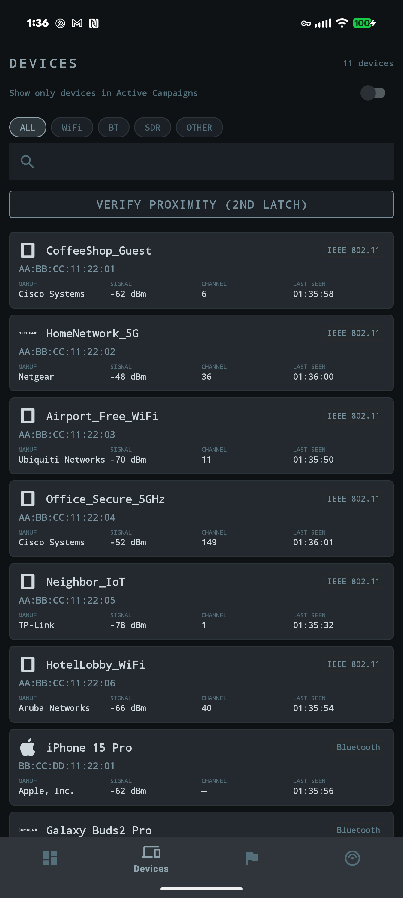
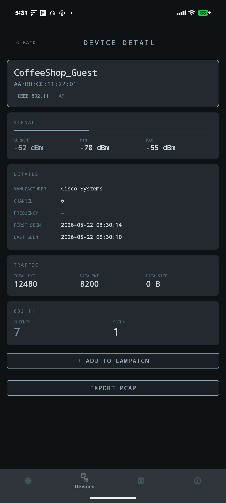
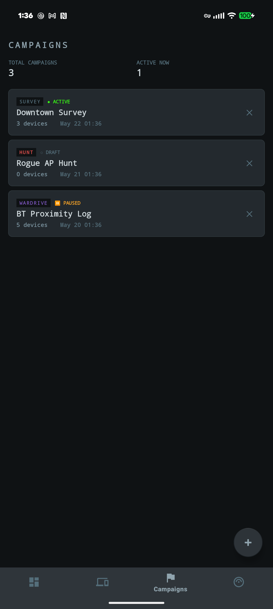
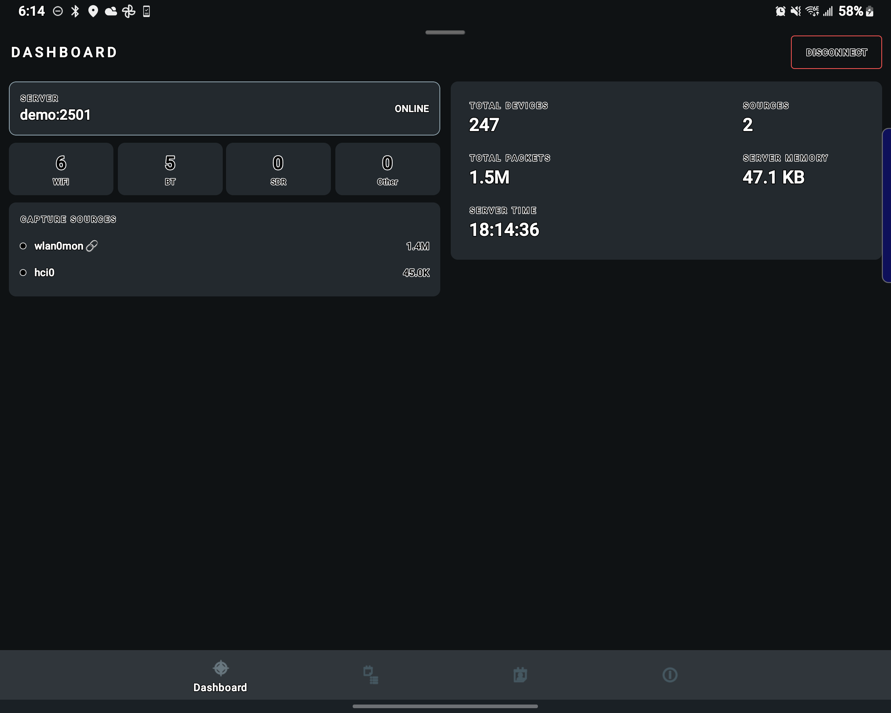
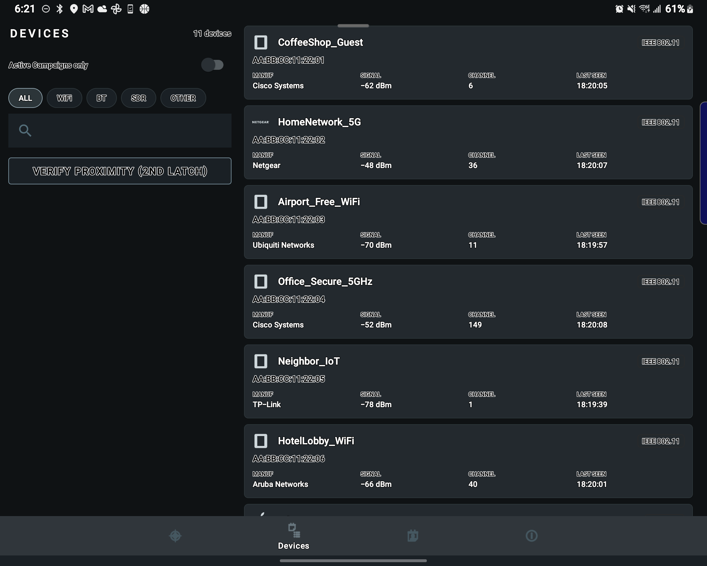
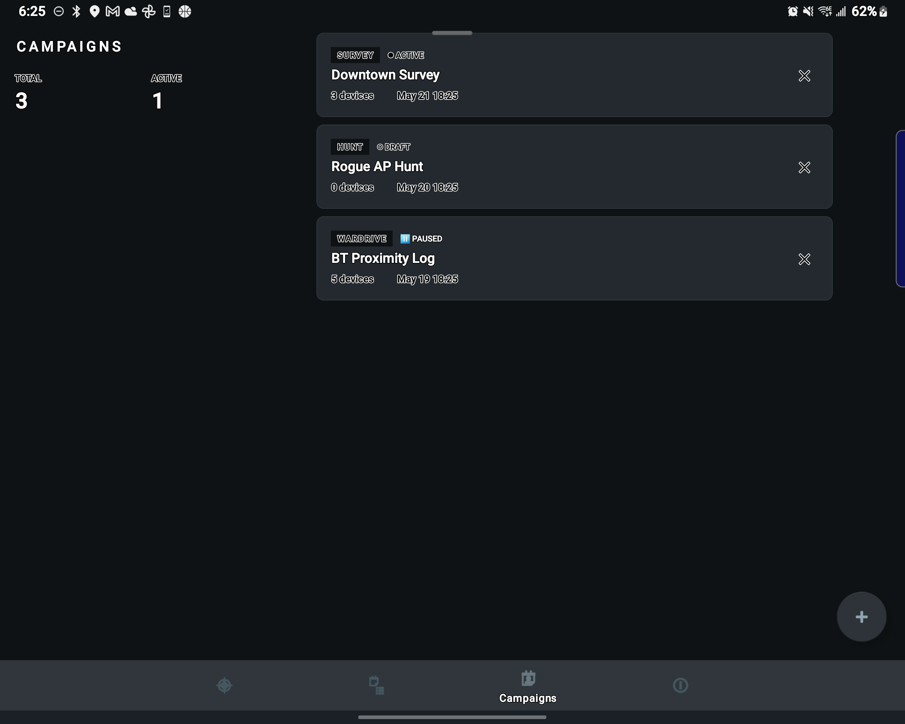
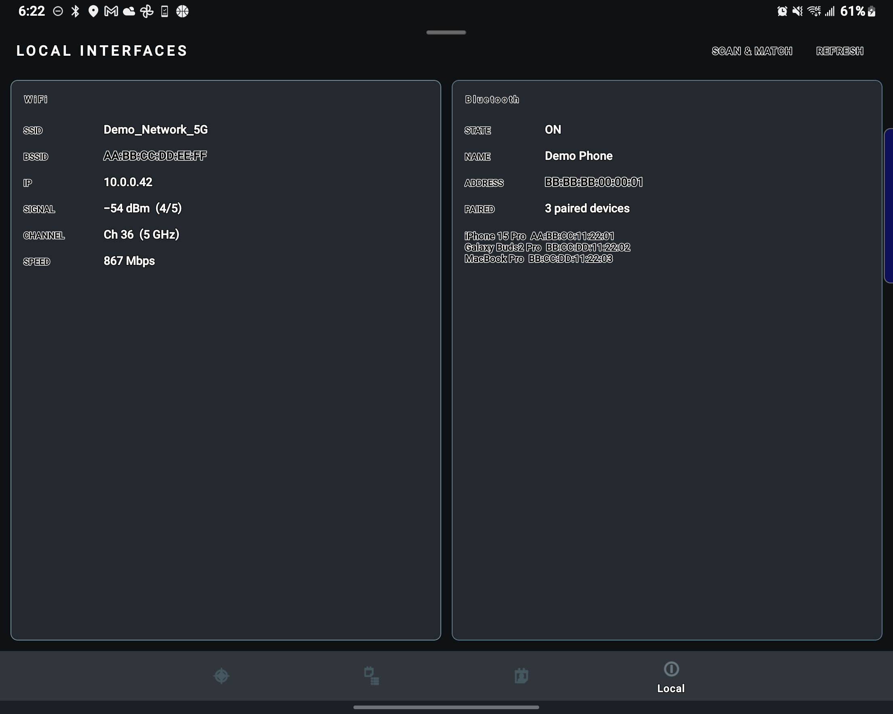

# KismetMobile

An Android client for the [Kismet](https://github.com/kismetwireless/kismet) wireless intrusion detection system.

   

**[Live demo / screenshots →](https://primary-null.github.io/KismetMobile/)**
<br>
**[📥 Download APK →](https://github.com/primary-null/KismetMobile/releases)**

---

## Screenshots

| Connect | Dashboard | Devices |
|---|---|---|
|  |  |  |

| Device Detail | Campaigns | Local Interfaces |
|---|---|---|
|  |  |  |

### Fold — Adaptive Layout

| Dashboard | Devices |
|---|---|
|  |  |

| Campaigns | Local Interfaces |
|---|---|
|  |  |

---

## Features

### Dashboard
- Live PHY counts — WiFi, Bluetooth, SDR, Other — with server memory, uptime, and packet totals
- Pull-to-refresh for an immediate data sync
- Tap a PHY card to jump to a filtered device list
- Long-press a capture source to stream its traffic as a `.pcapng` file

### Device Browser
- Search by name, MAC, or manufacturer; filter chips for each PHY type
- Campaign filter toggle — show only devices enrolled in active campaigns
- **Second Latch badge** — devices also seen by the phone's own radios are marked with a phone indicator
- Tap any device for full detail + **EXPORT PCAP** button

### Second Latch — Local Cross-Reference
- **SCAN & MATCH** button runs a combined WiFi + Bluetooth survey directly from the phone
- BLE scan uses `SCAN_MODE_LOW_LATENCY` — dense sighting collection within the 12-second window
- Classic BT discovery uses `RECEIVER_EXPORTED` flag for full Android 13+ broadcast compatibility
- Results cross-referenced against Kismet's device database by MAC address
- Requires `BLUETOOTH_SCAN` + `BLUETOOTH_CONNECT` at runtime (Android 12+)

### Campaigns
- Four types: **Survey** / **Hunt** / **Alert** / **Wardriving**
- Lifecycle: `DRAFT` → `ACTIVE` → `PAUSED` → `COMPLETE`
- Per-campaign alert rules with deduplication (fired alerts never repeat)
- Auto-collects matching devices while a campaign is active

### PCAP Capture
- `PcapCaptureService` foreground service streams a live `.pcapng` from the Kismet server
- Scope to a datasource UUID, a device key, or all traffic
- Stops automatically at 50 MB; auto-shares the file via `FileProvider` on stop

### WiGLE Export
- Converts campaign devices to **WiGLE WiFi 1.4 CSV** format (WiFi BSSIDs + Bluetooth MACs)
- One-tap upload using the API key configured in Settings

### SDR / HackRF Integration
- Detects installed Android SDR apps (RF Analyzer, SDR Touch, SDR++, CubicSDR) — links to Play Store if missing
- Live RF spectrum + waterfall view from Kismet's `/channels/channels.json`
- Band filter chips: ALL / 2.4G / 5G / 6G
- Kali SDR Tools sheet — copy-to-clipboard source strings and run commands for hackrf_sweep, rtl_433, dump1090, gnuradio, urh, inspectrum, multimon-ng

### Connectivity
- **SSH tunnel** — three auth modes supported:
  - **Local only** — direct connection, no tunnel
  - **Username + password** — password auth over SSH to a jump host
  - **Private key** — paste PEM key content directly into the app; supports OpenSSH v1 format (ed25519, ecdsa, rsa)
- Works with modern OpenSSH key exchange (curve25519 / ECDH)
- **WireGuard** — launches the WireGuard app when a VPN profile is required
- **InterfaceGuard** — verifies the active network interface before triggering monitor-mode actions
- Saved connection profiles with one-tap reconnect

### Adaptive Layout
- **Landscape** — Dashboard and Connect switch to a two-column layout; all stats and controls stay on screen without scrolling
- **Foldable / large screen** — screens ≥ 600dp wide (e.g. Galaxy Z Fold inner display) automatically use the two-column layout in portrait via `WindowSizeClass`
- **Tabletop mode** — when a foldable is half-opened with a horizontal hinge, content is pushed above the fold using `WindowInfoTracker` / `FoldingFeature`

---

## Requirements

- Android 10+ (API 29)
- Kismet server accessible on port `2501`
- For Second Latch Bluetooth scan on Android 12+: `BLUETOOTH_SCAN` + `BLUETOOTH_CONNECT` runtime permissions

## Build

```bash
./gradlew assembleStandardDebug
adb install -r app/build/outputs/apk/standard/debug/app-standard-debug.apk
```

## Usage

1. Launch the app and enter your Kismet server address, port, username, and password
2. Tap **CONNECT** (or tap a saved profile to auto-fill)
3. To connect through an SSH jump host, toggle **Use SSH Tunnel** and fill in the SSH host, port, and username — then either enter a password or paste your private key PEM directly into the key field
4. Navigate with the bottom bar: **Dashboard · Devices · Campaigns · Local Interfaces**
